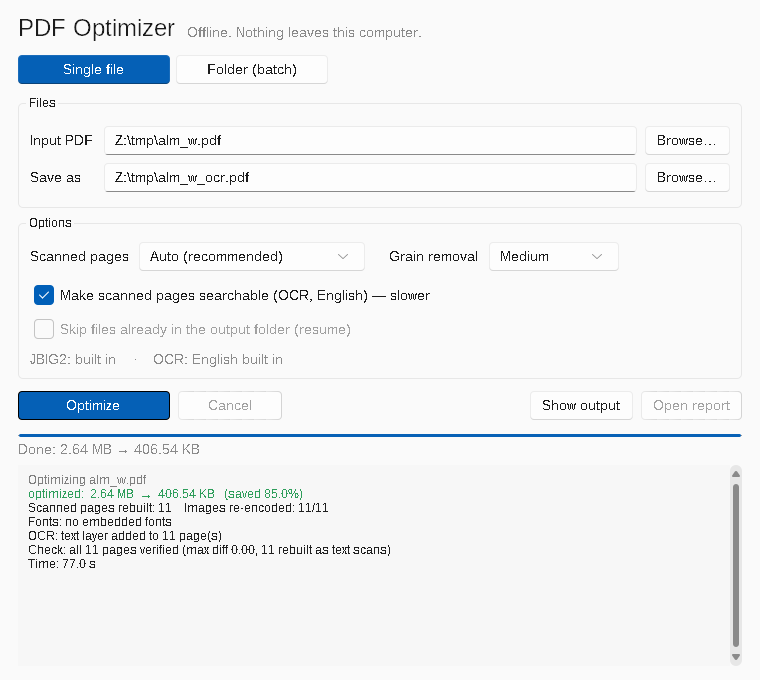

# PDF Optimizer

A portable, **offline** PDF compressor for Windows. Built for confidential documents that cannot be uploaded to online compressors: nothing leaves the computer.



## Features

- **Single file or whole folders.** Folder mode recreates the folder tree, optimizes every PDF under the same name, copies all other files, and writes a CSV report.
- **Images, done carefully.** Images are downsampled only when they are well above the target resolution (1.4× rule: 200 DPI colour/grey, 300 DPI black & white). JPEG quality is raised automatically where text or fine lines are detected. Black & white images use lossless JBIG2 (encoder built in), CCITT G4 or Flate, and are verified bit-for-bit.
- **Fonts.** Subsetting plus removal of TrueType hinting and unneeded tables. Pages must render identically, or the original fonts are kept.
- **Scan mode for scanned documents.** Full-page scans are rebuilt as sharp 300 DPI black text. Ink colours (stamps, blue signatures) and pictures (logos, seals, photos) are kept in colour where present. Includes grain/dust removal.
- **OCR (optional, English).** Adds an invisible text layer so scans become searchable. Rotated pages are handled.
- **Safety first.**
  - The input is never modified.
  - Every page is rendered before and after and compared.
  - If anything looks wrong, or the file does not get smaller, the original is kept.
  - Password-protected and digitally signed PDFs are copied unchanged.

Typical results: scanned documents 80–90% smaller; office documents with many embedded fonts 40–50%.

## Download

Get `PDF_Optimizer_Windows_portable.zip` from **[Releases](../../releases)**, unzip it, and run `PDF Optimizer.exe`. No installer or admin rights are needed.

The exe is not code-signed, so Windows SmartScreen may warn the first time: choose *More info → Run anyway*.

## Command line

```
pdfopt-cli.exe input.pdf [output.pdf] [--scan auto|bw|off] [--grain 0-3] [--ocr]
pdfopt-cli.exe INPUT_FOLDER OUTPUT_FOLDER [--scan ...] [--grain ...] [--ocr] [--skip-existing]
```

## Jupyter notebooks

`notebooks/` contains the same engine as single-file and batch notebooks. They need `pip install pymupdf pillow numpy fonttools`. For OCR, put `eng.traineddata` in a `tessdata` folder next to the notebooks.

## Building

- **Automatic:** every published release is built on GitHub Actions (`.github/workflows/build-windows.yml`), and the zip is attached to the release.
- **Manual:** run `build.bat` on Windows with Python 3.12 x64. The output is `dist\PDF Optimizer`.

| File | Purpose |
|---|---|
| `pdfopt_core.py` | Optimization engine |
| `pdfopt_batch.py` | Folder mode |
| `app_gui.py` / `app_cli.py` | GUI (tkinter + Sun Valley theme) / command line |
| `pdf_optimizer.spec` | PyInstaller build (GUI + CLI exe sharing one `_internal` folder) |
| `third_party/jbig2` | Static Windows build of jbig2enc + Leptonica, with licences |

## License

**GNU AGPL v3.** The app is built on PyMuPDF/MuPDF, which is AGPL-licensed. Bundled components and their licences are listed in [THIRD-PARTY-NOTICES.txt](THIRD-PARTY-NOTICES.txt).
